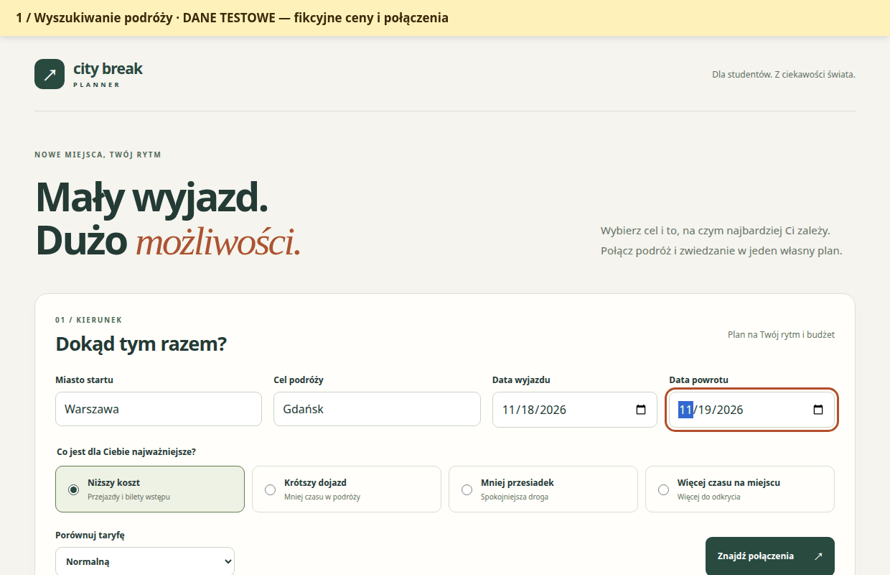

# City Break Planner

Planer krótkich wyjazdów, który łączy wybór transportu ze zwiedzaniem. Po zmianie godziny powrotu ma wskazywać, które atrakcje przestają mieścić się w planie.

## Aktualny zakres

Backend Java / Spring Boot / SQLite udostępnia wyszukiwanie, porównywanie
czterech priorytetów, przeliczanie harmonogramu i zapis planu. Frontend
React / TypeScript / Vite pozwala wybrać podróż, edytować atrakcje, zobaczyć
konflikty po zmianie powrotu oraz udostępnić zapisany plan do odczytu.

Domyślny tryb `live` odczytuje rzeczywisty rozkład linii 100 w Gdańsku
oraz dostępne oficjalne cenniki atrakcji. **Taryfa publikowana nie jest ofertą
wycenioną dla konkretnej rezerwacji.** API zwraca źródło i czas odczytu ceny;
niedostępne dane pozostają oznaczone jako niepotwierdzone.
Pełny scenariusz reguł planera można też sprawdzić w jawnym trybie danych
testowych opisanym niżej.

Wspólny [kontrakt REST](docs/api-contract.md) opisuje wyszukiwanie, cztery
priorytety, ceny i źródła, harmonogram, CRUD oraz odrębny publiczny odczyt.
Weryfikację dostępu do źródeł, pokrycie dat i ograniczenia opisuje
[raport SOL-115](docs/data-sources.md). Nie potwierdzamy dostępności konkretnego
kursu lub biletu na podstawie samego opublikowanego cennika.

## Zatwierdzony etap i dalsze doprecyzowanie

Właściciel zatwierdził pierwszy etap SOL-119: **Dworzec Główny ↔ Targ Rybny
w Gdańsku, linia 100**, wyłącznie w datach opublikowanych przez ZTM,
oraz dostępne oficjalne cenniki atrakcji. To lokalny odcinek w mieście,
nie połączenie Warszawa–Gdańsk. Przystanki po obu stronach Dworca mogą mieć
różne identyfikatory; adapter sprawdza rzeczywistą kolejność i godziny kursu.

**Zakres kolei, samolotów, autokarów, promów, pozostałych tras oraz dostawców
cen wymaga doprecyzowania w dalszym etapie projektu.** Ten etap nie oznacza
pełnego pokrycia wszystkich środków transportu. Nie zakładano kont,
nie kupowano dostępu i nie deklarujemy działania niezweryfikowanych API.

Rozkład i taryfa są odrębnymi źródłami. Błąd jednego cennika zachowuje dane
pozostałych źródeł. Brak pokrycia daty lub trasy nie oznacza braku kursów.
Jeśli nie potwierdzono godzin otwarcia, warunków ulgi lub czasu dojścia,
aplikacja pokazuje ten brak zamiast przyjmować dostępność lub zerowy dojazd.

## Najprostszy start — Docker

W głównym katalogu projektu wykonaj:

```bash
docker compose up --build -d
```

Otwórz **http://localhost:8080**. Compose zbuduje i uruchomi frontend,
backend oraz utworzy bazę SQLite w trwałym wolumenie. W tym wariancie
potrzebujesz tylko Dockera z Compose i obsługą kontenerów linuksowych;
Java, Maven i Node są dostarczane przez obrazy. Pierwsze budowanie pobiera
obrazy i zależności z internetu.

### Szybkie sprawdzenie planera

1. **Rzeczywisty rozkład ZTM.** Po domyślnym starcie otwórz formularz i kliknij
   „Uzupełnij przykładową trasę”. Formularz uzupełni **Dworzec Główny → Targ Rybny**
   oraz jutrzejszą datę w obu kierunkach. Zmień datę, jeśli źródło nie obejmuje
   tego dnia, i kliknij „Znajdź połączenia”.
2. **Pełne demo.** Włącz `APP_DATA_MODE=demo` w pliku `.env.docker` i uruchom
   Compose z `--env-file .env.docker` według instrukcji poniżej. Kliknij
   „Uzupełnij przykładową trasę”, wyszukaj **Warszawa → Gdańsk** z domyślną
   taryfą normalną i priorytetem „Niższy koszt”, a następnie wybierz kartę
   z powrotem o **14:00**. Harmonogram wskaże konflikt przy atrakcji. Zapisz
   plan i otwórz link tylko do odczytu w osobnym oknie. Ten sam przebieg
   pokazuje [demonstracja GIF](docs/media/demo.gif). Dane w tym trybie są
   jawnie oznaczonymi przykładami.

Frontend przekazuje `/api` do backendu przez Nginx. Linki do zapisanych
planów używają tego samego adresu. SQLite działa wewnątrz backendu,
a plik bazy znajduje się w wolumenie.

```bash
docker compose ps
docker compose logs -f --tail=100
docker compose down
```

`down` zatrzymuje kontenery i **zachowuje zapisane plany**. Ponowny start
korzysta z tego samego wolumenu `planner_data` i pliku
`/data/city-break-planner.db`. Domyślne uruchomienie tworzy nową bazę
kontenerów; dane są usuwane dopiero przy usunięciu wolumenu.

Domyślnie działa tryb `live` z zatwierdzonym zakresem opisanym poniżej.
Aby zmienić port lub włączyć jawne dane testowe, przygotuj opcjonalny plik:

```bash
cp .env.docker.example .env.docker
docker compose --env-file .env.docker up --build -d
```

Przed uruchomieniem edytuj `.env.docker`: np. `APP_PORT=18080` zmienia adres
na `http://localhost:18080`, a `APP_DATA_MODE=demo` włącza oznaczone fikcyjne
przykłady. Port jest automatycznie uwzględniany w linkach i konfiguracji API.
`APP_FRONTEND_BASE_URL` pozwala podać inny publiczny adres. Przy dalszych
poleceniach używaj tego samego `--env-file .env.docker`.

Techniczne sprawdzenie kontenerów: [SOL-122](docs/docker.md).

## Wymagania przy uruchomieniu bez Dockera

- JDK 17–25; lokalna weryfikacja na Java 25.
- Node.js 22.22.2+ z linii 22 LTS oraz npm 10; `.nvmrc` wskazuje linię 22.
- Dostęp do internetu przy pierwszym pobieraniu zależności i Maven Wrapper.

Maven jest dostarczany przez wrapper w `backend/`; instalacja systemowa
Mavena ani serwera SQLite nie jest potrzebna. Przy zainstalowanym `nvm`
uruchom w katalogu repozytorium `nvm install && nvm use`.

## Uruchomienie lokalne

Otwórz dwa terminale w katalogu repozytorium. W pierwszym:

```bash
cd backend
./mvnw spring-boot:run
```

Backend: `http://127.0.0.1:8080`. SQLite automatycznie tworzy lokalny plik
`backend/city-break-planner.db`, ignorowany przez Git. Plik zachowuje się
między uruchomieniami; zapis planów tworzy wymagany schemat przy pierwszej
operacji na repozytorium planów.

W drugim terminalu:

```bash
cd frontend
npm ci
npm run dev
```

Otwórz **http://localhost:5173**. Wyszukiwanie wymaga działającego backendu.
Vite ma stały port: gdy 5173 jest zajęty, zwolnij port zamiast zmieniać origin
bez dostosowania CORS. `localhost` i `127.0.0.1` to różne originy.

Sprawdzenie API:

```bash
curl --fail http://127.0.0.1:8080/api/v1/health
```

Oczekiwane HTTP 200 i `{"status":"UP","database":"UP"}`. Awaria bazy daje
HTTP 503 i `{"status":"DOWN","database":"DOWN"}`. Wyłączony backend
powoduje czytelny błąd na stronie i pozwala ponowić sprawdzenie.

## Wyszukiwanie danych rzeczywistych

Możesz sprawdzić dane rzeczywiste bez dodatkowych
kluczy: uruchom domyślny backend i frontend, wpisz **Dworzec Główny** oraz
**Targ Rybny**, a następnie wybierz daty z opublikowanego zakresu ZTM.
Zakres może się zmieniać; odpowiedź API podaje brak pokrycia dla zbyt
odległej daty. Lista pokazuje do 24 wariantów po porównaniu wszystkich
znalezionych par według wybranego priorytetu. Nie jest pełnym spisem kursów.

## Pełny przebieg na danych testowych

W terminalu backendu, zamiast domyślnego polecenia uruchomienia:

```bash
cd backend
APP_DATA_MODE=demo ./mvnw spring-boot:run
```

Frontend uruchom bez zmian. Tryb `demo` zwraca **wyłącznie fikcyjne, kontrolowane
przykłady**. Są oznaczone `testData: true` przez API i komunikatem w interfejsie.
Pokazane ceny i godziny nie stanowią rzeczywistych ofert, także po zapisie
i udostępnieniu planu. Nie używaj ich do zakupu lub planowania faktycznej podróży.

1. Podaj start, cel i przyszłe daty, wybierz jeden priorytet i wyszukaj.
2. Porównaj warianty, rozwiń etapy podróży i wybierz połączenie.
3. Dodawaj i usuwaj atrakcje oraz zmieniaj ich kolejność. Harmonogram oblicza API.
4. Wybierz wcześniejszy powrót. Punkty pozostają w planie, a przy kolizjach
   pojawiają się powody, uwzględniające dojazd i godziny otwarcia.
5. Zapisz plan i skopiuj link do odczytu. Otwórz go w osobnej sesji przeglądarki:
   odbiorca widzi plan bez kontrolek edycji.

Token edycji jest zapamiętywany lokalnie przez przeglądarkę dla danego planu.
Link do odczytu go nie zawiera. Wyczyszczenie danych przeglądarki oznacza
utratę lokalnego prawa edycji; nie ma jeszcze kont ani odzyskiwania tokenu.
Publiczny link pozostaje aktywny do usunięcia planu. Zapisane plany można
odczytać po ponownym uruchomieniu backendu z tym samym plikiem SQLite.

## Konfiguracja

Domyślne ustawienia wystarczają do startu. Szablony:
[backend/.env.example](backend/.env.example),
[frontend/.env.example](frontend/.env.example).

| Zmienna | Domyślna wartość | Odbiorca |
| --- | --- | --- |
| `SERVER_ADDRESS` | `127.0.0.1` | backend |
| `SERVER_PORT` | `8080` | backend |
| `SPRING_DATASOURCE_URL` | `jdbc:sqlite:./city-break-planner.db` | backend |
| `APP_CORS_ALLOWED_ORIGINS` | `http://localhost:5173` | backend; lista po przecinku |
| `APP_FRONTEND_BASE_URL` | `http://localhost:5173` | backend; baza linków do odczytu |
| `APP_DATA_MODE` | `live` | backend; `demo` włącza jawne przykłady testowe |
| `APP_SOURCE_TIMEOUT_SECONDS` | `3` | backend; limit odczytu źródła, zakres 1–5 s |
| `VITE_API_BASE_URL` | `http://localhost:8080/api/v1` | frontend; adres publiczny |

Spring Boot nie wczytuje automatycznie `.env`. Dla własnej konfiguracji
w terminalu backendu wykonaj (Bash, plik lokalny pod własną kontrolą):

```bash
cd backend
cp .env.example .env
# Dostosuj .env przed uruchomieniem.
set -a
source .env
set +a
./mvnw spring-boot:run
```

W frontendzie `cp .env.example .env.local`; Vite wczyta ten plik po ponownym
uruchomieniu. Nigdy nie dodawaj sekretów do `VITE_*` — trafiają do przeglądarki.
Zatwierdzone źródła lokalne nie wymagają kluczy API. Dane pobiera serwer,
z ograniczeniem czasu i rozmiaru odpowiedzi. Nazwy zmiennych i zasady
dostępu przyszłych dostawców ustalimy po doprecyzowaniu kolejnego etapu;
żadnych kluczy dostawców nie przekazujemy do przeglądarki.

## Testy i budowanie

Z katalogu `backend/`:

```bash
./mvnw test
./mvnw package
java -jar target/city-break-planner-0.0.1-SNAPSHOT.jar
```

Z katalogu `frontend/`:

```bash
npm ci
npm test
npm run build
```

Testy backendu sprawdzają SQLite, health i CORS, pełny CRUD i uprawnienia,
priorytety oraz konflikty harmonogramu. Testy frontendu używają kontrolowanych
odpowiedzi API do sprawdzenia wyszukiwania, edytora i widoku publicznego.
Build sprawdza TypeScript i tworzy `dist/`.
Backend i Vite muszą działać jednocześnie, aby ręcznie sprawdzić pełne połączenie.
### Uruchomienie w Windows PowerShell

Z katalogu repozytorium uruchom backend w pierwszym terminalu. Aby sprawdzić
scenariusz testowy, ustaw wcześniej w tym terminalu `$env:APP_DATA_MODE = 'demo'`.

```powershell
Set-Location backend
.\mvnw.cmd -B -ntp package
java -jar target/city-break-planner-0.0.1-SNAPSHOT.jar
```

Z katalogu repozytorium uruchom frontend w drugim terminalu.

```powershell
Set-Location frontend
npm.cmd ci
npm.cmd run dev
```

Otwórz **http://localhost:5173**. Tryb danych zmienisz po zatrzymaniu backendu
i ponownym wykonaniu polecenia `java -jar` z odpowiednią wartością `APP_DATA_MODE`.

Wyniki i granice aktualnego odbioru opisuje [raport SOL-120](docs/acceptance.md).
[Raport SOL-115–118](docs/verification.md) zachowuje historię sprawdzenia
wcześniejszego etapu. Dane testowe i wyniki rzeczywistych odczytów są
raportowane oddzielnie.

### Testy całego przepływu

Osobny pakiet E2E wymaga Chrome albo przeglądarki zainstalowanej przez
Playwright. Pracuje na własnych portach i tymczasowym SQLite:

```bash
cd e2e
npm ci
# Jeśli nie masz lokalnego Chrome: npx playwright install chromium
npm test
```

Deterministyczny zestaw używa jawnych danych testowych. Osobne sprawdzenie
rzeczywistych źródeł wymaga daty w aktualnym zakresie rozkładu:

```bash
E2E_LIVE_DATE=2026-11-14 npm run test:live
```

Data jest przykładem weryfikacji, a nie trwałą gwarancją pokrycia.
Szczegóły, wyniki i zakres testów są w [raporcie SOL-120](docs/acceptance.md).

## Architektura

Frontend komunikuje się bezpośrednio z REST Spring Boot. Warstwa `api`
obsługuje HTTP, `service` walidację i uprawnienia, `planning` ranking
i harmonogram, `provider` ograniczone czasem i rozmiarem odczyty źródeł,
a `persistence` atomowe migawki planów w SQLite. Cenniki HTML odczytuje
Jsoup. Token właściciela przechowujemy w bazie jako hash; publiczny link
używa niezależnego tokenu i osobnego endpointu tylko do odczytu.

## Nagranie i przygotowanie oddania

[Otwórz demonstrację GIF](docs/media/demo.gif) — rzeczywisty interfejs i API,
**wyłącznie fikcyjne dane testowe**, stale oznaczone na nagraniu.



[Instrukcja wydania](docs/release.md) opisuje ponowne nagranie, weryfikację
artefaktu i listę kontroli właściciela. Końcowe sprawdzenie repozytorium
i wysłanie linku z imieniem i nazwiskiem do Xelerit pozostaje działaniem
właściciela, przed **15 listopada 2026, 23:59 Europe/Warsaw**.

## Organizacja dalszej pracy

`backend/` odpowiada za REST, walidację, planowanie, SQLite i dostawców;
`frontend/` za widoki i komunikację z API; `docs/api-contract.md` jest wspólną
umową. Koordynator uzgadnia jej zmiany przed równoległą implementacją.

SOL-115 weryfikuje źródła na konkretnych trasach i datach. SOL-116 obejmuje
zapis i uprawnienia, SOL-117 planowanie, SOL-118 widoki, SOL-119 integracje.
Dalsze niezależne prace zaczynaj z tej samej aktualnej gałęzi bazowej,
w osobnych worktrees. Nie uznawaj braku ceny albo awarii dostawcy za
potwierdzony brak połączenia. Zakres obsługiwanych tras zatwierdza właściciel.

Przy implementacji wykorzystano Codexa do koordynacji zadań z Linear,
pracy agentów nad backendem, frontendem i weryfikacją źródeł, a także testów
i niezależnej recenzji. Instrukcje projektowe oraz kontrakt są wersjonowane
w repozytorium; decyzje o zasięgu produktu i źródłach należą do właściciela.

Instrukcje dla agentów są w [AGENTS.md](AGENTS.md), [backend/AGENTS.md](backend/AGENTS.md) i [frontend/AGENTS.md](frontend/AGENTS.md).
