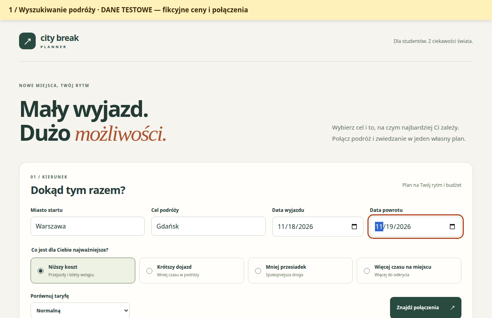

# SOL-121 — przygotowanie wydania i nagrania

Repozytorium: [wikt0r2115/city-break-planner](https://github.com/wikt0r2115/city-break-planner).
11.11.2026 potwierdzono przez API GitHuba `private: false` i główną gałąź
`main`. Publiczne repozytorium nie oznacza opublikowanego hostingu aplikacji.

## Zatwierdzony etap i dalsze doprecyzowanie

Właściciel zatwierdził pierwszy etap rzeczywistych integracji: linię 100
w Gdańsku, Dworzec Główny ↔ Targ Rybny, wyłącznie w zakresie dat dostępnych
w źródle, oraz potwierdzone cenniki atrakcji. Publikowana taryfa jest
odróżniana od wyceny konkretnego kursu. Brak danych lub zakresu dat nie
oznacza potwierdzonego braku połączenia.

**Pełny zakres tras, dostawców, kolei, lotów, autokarów, promów i pozostałych
źródeł cen pozostaje do doprecyzowania w dalszym etapie projektu.**
Nie deklarujemy rzeczywistych cen między miastami bez potwierdzonego dostępu.
Stan źródeł i ograniczenia opisuje [raport SOL-115](data-sources.md),
a odbiór zintegrowanej wersji — raport SOL-120 przygotowywany wraz z kodem.

## Materiał demonstracyjny

[Otwórz animację GIF](media/demo.gif) · [metadane i SHA256](media/demo.json)



Animacja przedstawia **rzeczywiste działanie interfejsu z uruchomionym API**,
ale używa wyłącznie kontrolowanego dostawcy `APP_DATA_MODE=demo`.
Połączenia Warszawa → Gdańsk, ceny i atrakcje w tym filmie są fikcyjne.
Nie stanowią dowodu działania rzeczywistych źródeł ani oferty sprzedaży.
Oznaczenie danych testowych jest stale widoczne, również po przewinięciu.
Daty nagrania wybiera skrypt względem dnia uruchomienia.

Siedem etapów obejmuje formularz, wyniki, wybranie powrotu o 14:00,
konflikt z zachowaniem wybranych miejsc, zapis, otwarcie linku w oddzielnej
sesji i publiczny harmonogram bez kontrolek edycji. Film ma 15 sekund,
rozdzielczość 1240 × 800 i rozmiar poniżej 1 MB. Jest złożony z faktycznych
zrzutów przeglądarki; podpisy etapów dodaje wyłącznie skrypt nagrania.

Sprawdzono dekodowanie każdej klatki i odtwarzanie w Chrome: obraz animacji
zmienia się po przejściu do następnej klatki. Metadane zapisują rzeczywisty
czas nagrania, rewizję źródeł, wersję enkodera, czas trwania i sumę pliku.
Token edycji nie pojawia się w obrazie, metadanych ani komunikatach skryptu.
Widoczny link publiczny dotyczy wyłącznie tymczasowej bazy demonstracyjnej.

## Powtórzenie nagrania z czystego checkoutu

Wymagane: JDK 17–25, Node 22.22.2+, Python 3 z Pillow oraz Chrome/Chromium
lub przeglądarka zainstalowana przez Playwright. Instrukcje uruchomienia
aplikacji i konfiguracji są w głównym README.

W katalogu repozytorium przygotuj artefakty aplikacji:

```bash
cd backend
./mvnw package
cd ../frontend
npm ci
cd ../e2e
npm ci
cd ..
```

Skrypt wykorzystuje przypięty Playwright z pakietu `e2e/`. Jeżeli nie masz
lokalnego Chrome/Chromium, zainstaluj Chromium przez Playwright zgodnie
z instrukcją pakietu E2E. Na Windows `mvnw.cmd` zastępuje `./mvnw`.

Pillow można przygotować w osobnym środowisku, bez instalacji systemowej:

```bash
python3 -m venv /tmp/city-break-recording-tools
/tmp/city-break-recording-tools/bin/python -m pip install 'Pillow>=10.2'
PYTHON=/tmp/city-break-recording-tools/bin/python node scripts/record-demo.mjs
```

Jeżeli Pillow jest już dostępny w `python3`, wystarczy:

```bash
node scripts/record-demo.mjs
```

| Zmienna opcjonalna | Znaczenie |
| --- | --- |
| `CHROME_EXECUTABLE` | Ścieżka do lokalnego Chrome/Chromium; bez niej skrypt szuka typowych instalacji lub używa przeglądarki Playwright. |
| `PLAYWRIGHT_MODULE` | Ścieżka do istniejącego pakietu Playwright; domyślnie używany jest `e2e/node_modules/playwright`. |
| `PYTHON` | Interpreter Pythona z Pillow. |
| `RECORD_BACKEND_JAR` | Alternatywny, wcześniej zbudowany JAR backendu. |
| `RECORD_FRONTEND_DIR` | Alternatywny katalog frontendu z zainstalowanymi zależnościami. |
| `RECORD_OUTPUT` | Ścieżka docelowa zakończona `.gif`; domyślnie `docs/media/demo.gif`. |

`node scripts/record-demo.mjs --help` wyświetla wymagania bez uruchamiania
serwerów. Tylko w izolowanym środowisku bez dostępnego sandboxa Chrome można
jawnie ustawić `CHROME_NO_SANDBOX=1`; domyślnie skrypt go nie wyłącza.
Skrypt sprawdzono na Linuxie; Windows i macOS nie były weryfikowane.

## Odtwarzalność i wycofanie

Nagrywanie uruchamia własne procesy Java i Vite na losowych portach loopback.
Tworzy prywatny katalog tymczasowy i osobny SQLite, bez używania bazy
użytkownika i bez zajmowania stałych portów 8080/5173. Po sukcesie, błędzie
lub przerwaniu skrypt zatrzymuje wyłącznie swoje procesy i usuwa własne
pliki tymczasowe. Nie szuka procesów do zabicia po nazwie ani po porcie.

Nowy GIF jest najpierw kodowany i sprawdzany w pliku roboczym. Dopiero
potwierdzone dekodowanie i odtwarzanie pozwala zastąpić poprzednią animację.
Nieudane nagranie zachowuje istniejący materiał. Wycofanie commita nagrania
dotyczy wyłącznie skryptu, instrukcji i mediów; nie zmienia bazy aplikacji.

Sprawdzono również celowy błąd startu Chrome oraz przerwanie SIGINT po
uruchomieniu obu serwerów. W obu przypadkach poprzedni GIF pozostał
niezmieniony; katalog tymczasowy usunięto, a własne procesy zakończono.

## Kontrola właściciela przed wysłaniem

- Sprawdź końcową wersję `main`, README, zakres rzeczywistych danych i raport
  SOL-120. Braki pokrycia muszą pozostać opisane jawnie.
- Otwórz `docs/media/demo.gif` bezpośrednio w przeglądarce i potwierdź,
  że pokazuje właściwy zakres oraz stałe oznaczenie danych testowych.
- Uruchom projekt zgodnie z instrukcją z czystego klonu i sprawdź podstawowy
  przepływ oraz brak prawa edycji u odbiorcy linku.
- Uzupełnij własne imię i nazwisko. Właściciel wysyła link do repozytorium
  do Xelerit **do 15 listopada 2026, godz. 23:59 czasu Europe/Warsaw**.

Nie wysłano zgłoszenia, wiadomości ani danych osobowych do Xelerit.
Końcowe zatwierdzenie i wysłanie pozostają działaniem właściciela.
Przygotowanie nagrania nie zamyka automatycznie zależności SOL-120 ani
potwierdzenia wysyłki wymaganego w SOL-121.

Codex był faktycznie używany do koordynowania zadań z Linear, implementacji,
sprawdzenia źródeł, testów i niezależnej recenzji. Nagranie jest wykonywane
przez Playwright na działającej aplikacji; nie jest generowanym obrazem UI.
